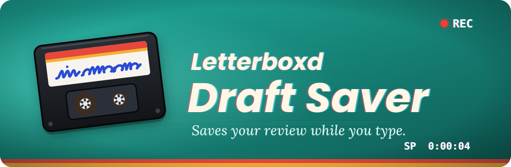
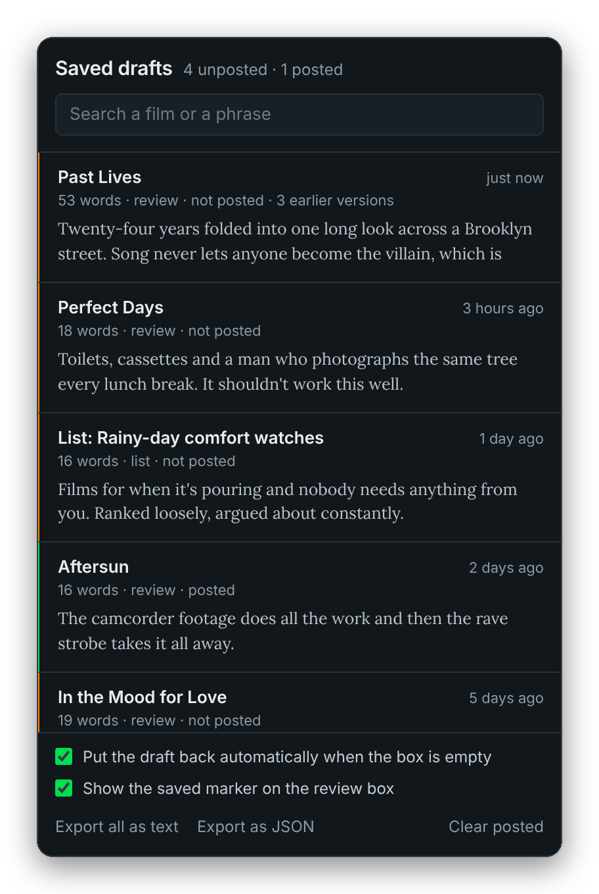
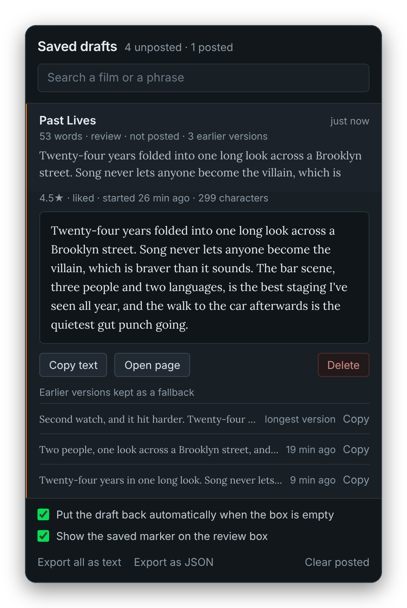

  

  Chrome crashes, the laptop dies, the tab closes, you hit the wrong key. 
  <b>The words are still there when you come back.</b>

  
  

## Install

1. Download this repo (the green **Code** button, then **Download ZIP**) and unzip it somewhere permanent.
2. Go to `chrome://extensions` and turn on **Developer mode** (top right).
3. Click **Load unpacked** and pick the folder with `manifest.json` in it.
4. Open any film on Letterboxd, click the review box and type a few words. A small **Draft saved** marker appears in the corner of the box.

> [!TIP]
> Chrome loads the extension from disk every time it launches, so don't leave the folder in Downloads if you're the type to empty that folder.

## How it works

Every keystroke in a review box (or a list description, or a comment) is written to two places.

| Where | Why |
| :-- | :-- |
| **`chrome.storage.local`** | The real store. It's what the toolbar popup reads, and it survives crashes, restarts and closing Chrome entirely. |
| **`localStorage` on letterboxd.com** | A synchronous mirror written on the same tick as the keystroke. `chrome.storage` writes are asynchronous, so a hard crash can in theory eat the last few hundred milliseconds. The mirror can't, because it lands before the browser gets a chance to die. |

On the next page load the two are compared and the newer one wins.

| When you | It saves |
| :-- | :-- |
| stop typing | 400 ms later |
| keep typing | at least every 4 seconds |
| switch tabs, minimise, close the modal, press <kbd>Esc</kbd> or leave the page | straight away |
| press <kbd>Ctrl</kbd>+<kbd>S</kbd> (<kbd>⌘</kbd>+<kbd>S</kbd> on a Mac) | straight away |

## Getting a draft back

Open the review box again. If it's empty and a draft exists, the draft goes straight back in and a toast offers **Undo**. If the box already has something in it (you're editing a posted review, say), nothing is overwritten. The toast offers to restore instead, and shows you what it's holding first.

The toolbar icon shows how many unposted drafts exist. Click it for the full list, where you can search, read, copy, or open the film page. Every draft also keeps earlier versions as a fallback:

- **The longest version ever typed.** The parachute for a select-all-and-type accident.
- **The text from just before the box went empty.**
- **Up to eight snapshots** taken as you write, whenever the length changes by 180 characters or two minutes pass since the last one.

## When drafts go away

Nothing is deleted while a draft is unposted. Once Letterboxd actually saves the entry (confirmed by the form closing, not just by you clicking Save), the draft is marked as posted and kept for another seven days as a backup, then pruned. You can clear posted ones by hand from the popup footer, and export everything as text or JSON any time.

## Privacy

It only runs on letterboxd.com, with no background network access. Nothing ever leaves your machine: there's no server, no analytics, no remote anything. The only permissions it asks for are `storage`, `unlimitedStorage` and access to letterboxd.com.

## Limits worth knowing

> [!NOTE]
> **Rating and tags are recorded but not re-applied.** The star widget and the tag typeahead are custom controls, and forcing values into them tends to leave the form in a state Letterboxd disagrees with. The restore toast and the popup tell you what the rating and tags were, so you can click them again in two seconds. Liked, rewatch and the spoiler checkbox *are* restored.

- **Clearing site data wipes the mirror**, not the real store. Clearing extension data (or removing the extension) wipes both.
- **Letterboxd redesigns things.** Field detection falls back to "any review-ish textarea in a diary form", so a rename of `#frm-review` shouldn't break it. If drafts stop appearing in the popup, that's the first thing to check.

 

An independent project, not affiliated with or endorsed by Letterboxd.

